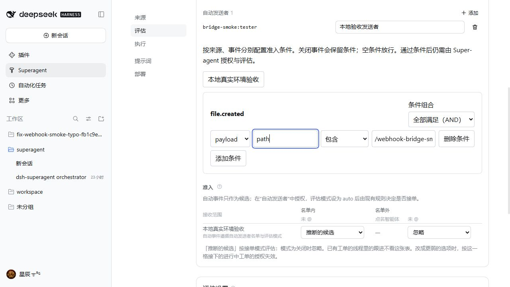

# 本地 3082 真实环境验收

日期：2026-11-18，Asia/Shanghai。用户明确指定 `http://127.0.0.1:3082/`。

环境为现有 Docker Super-agent，DSH 0.2.1-rc.3、Node 24.22.3。通过现有 profile 安装后端插件，适配容器内 Super-agent 前端并实际构建、打开浏览器验证。没有将独立 mock 服务冒充此环境。

## 实测结果

| 项目 | 结果 |
|---|---|
| 插件注册 | Webhook 来源 ready |
| 来源界面 | 独立卡片、启用开关、URL 路径、隐藏密钥、事件开关可见 |
| 评估界面 | Webhook 标签、来源选择、事件独立 AND/OR 条件可见 |
| 条件保存 | 浏览器填写 payload.path 包含 /webhook-bridge-smoke/，保存成功并生成新策略版本 |
| 错误密钥 | 401 unauthorized |
| 未订阅事件 | 202 filtered / event_disabled |
| 正常事件 | 202 queued，后台转 stored，attempts=0 |
| 相同事件重复提交 | 200，duplicate=true |
| 已保存条件不匹配 | 202 filtered / conditions |
| 真实模型准入 | inferred 候选按现有 copy 规则 accept |
| 真实执行 | 工单 ended，outcome=completed，独立验收文件实际修改完成 |
| 现有业务保留 | QQ 配置与原始快照逐值相同；原有接单规则逐值相同；QQ ready |

测试事件：`4d3da299-7792-4fa1-bd46-941fe7367ecc`。
工单：`fb1c9e150e1f6df24390ff2d110bee1d`。

验收文件 `/home/node/workspace/webhook-bridge-smoke/README.md`，由测试脚本单独创建：

```diff
-teh webhook bridge
+the webhook bridge
```

宿主记录：09:22:22 UTC 接单、09:22:30 UTC 执行完成，即北京时间17:22:22至17:22:30。核对了工单 completed 状态、执行器报告及文件实际字节内容。测试使用现有模型配置，没有替换模型或扩大原有接单规则。

## 发现并修复

1. 原前端导入被 tsdown 当作外部 npm 依赖，浏览器模块表缺失，整个 Super-agent 页面加载失败。适配器改为将 UI 及声明复制到宿主源码并用相对路径导入，保证组件实际进入客户端 bundle；重新构建并在浏览器确认页面正常。
2. 已保存来源的默认空 callbackUrl 在再次校验时调用 new URL('') 抛错，影响来源读取与事件接收。改为不会抛异常的 HTTPS 校验，新增默认值往返校验回归测试。后端更新至1.0.2并重启确认。
3. 现有 loopback-forwarder 与主容器共享网络命名空间，单独重启主容器后宿主3082暂时空响应；同步重启原有 forwarder 后恢复。未新建公网入口。

## 留存与限制

安装前配置、前端文件及 SQLite 在线一致性备份位于容器 `/home/node/.dsh/plugin-packages/bridge-backup-20261118/`。备份包含现有环境私密配置，未放入代码包。测试密钥仅保留在容器本地测试回执文件，未放入报告或源码。

验收来源 `bridge-smoke` 已在完成后关闭，卡片、条件、工单和测试文件保留供核对。现有 QQ 来源与规则未改动。插件保持安装。

独立9088监听在容器内部，本次从容器内部调用；未修改 Docker 端口映射、未对公网暴露新端口。若业务发送方位于容器外，部署时须单独配置受控代理或端口映射。

本次未配置真实外部 HTTPS 回调接收方，因此不把外部结果回传算作已完成端到端验收；回调仍以已有自动化传输及错误重试测试为证。未执行长时间负载测试。



## 1.0.3 界面统一

已在3082实际页面核对：原生与 Webhook 标签均为同一系统字体栈、13px字号；输入框32px高度，使用原生 dt-input、dt-select、dt-btn 和宿主主题变量。来源与事件改为右侧36×20滑动开关，统一卡片圆角、边框和表单间距。22项测试通过，宿主构建通过。效果见 native-style.jpg。
